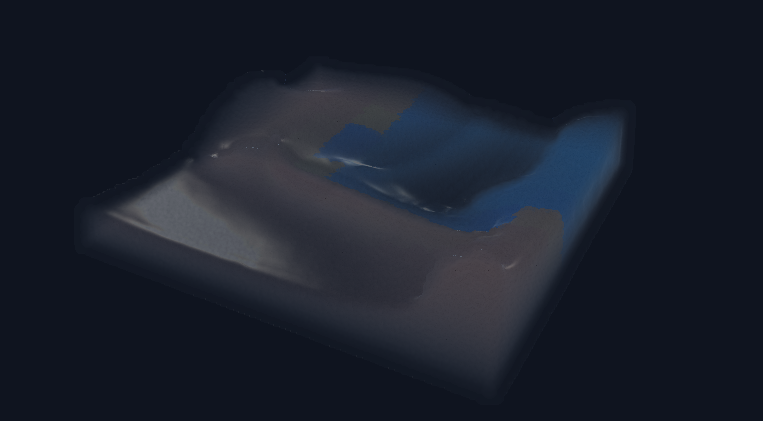

# PhreeGUI
> 打造最真实的科普级化学模拟GUI系统。


[🇨🇳 中文](README.md) | [🇬🇧 English](README_en.md)

## 📖 简介
致力于解决当前化学模拟软件普遍：简单好上手-真实性-付费的不可能三角，当前开发了一个demo，可供体验。


> 
## ✨ 特性

- 🚀 **高真实性**：以Phreeqcrm为化学核心，splishsplash提供的dfsph为物理核心，利用ssfr进行渲染，做到了准科研级的真实模拟
- 🛠 **易用性**：使用该项目只需要三步：克隆-安装-使用
- 🔌 **扩展性**：预留了丰富的开发接口

## 📦 安装

先装仓库内置的 PhreeqcRM 线程修复版 wheel，再装其余依赖：

```bash
pip install wheels/phreeqcrm-0.0.20-cp312-cp312-win_amd64.whl
pip install -r requirements.txt
```

为什么需要这个 wheel：

- PyPI 原版 PhreeqcRM 0.0.20 在 `nthreads > 1` 时会在 `RunCells` 内段错误（Windows 退出码 139），原因见 [`wheels/phreeqcrm-thread-fix.v3.patch`](./wheels/phreeqcrm-thread-fix.v3.patch)（改 `PhreeqcRM.cpp` / `PhreeqcRM.h` / `swig/PhreeqcRM.i`）。
- 本仓库 wheel 的 SHA-256：`af958509ae9403f648bbf342008eb139912a0f0cb1a8b9499dfa98b9188f8062`（win_amd64 + CPython 3.12）。
- 若换回 PyPI 原版 wheel，必须把 `phreeqc_config.DEFAULT_NTHREADS` 改回 `1`，否则多线程化学步会直接崩溃。
- 非 win_amd64 / CPython 3.12 平台：按同一补丁自行编译，或使用原版并把 `DEFAULT_NTHREADS` 设为 1。

## 🚀 快速开始
打开launch_coupled_simulation.py，点击开始模拟，你可以在右边的3d显示窗口看到模拟状态，使用左键来创建粒子，右键移动摄像机。

### 物理后端切换（CPU / Taichi GPU）

默认使用 Taichi GPU 版 DFSPH（未装 `taichi` 或 CUDA 不可用时会直接报错）。切回 SPlisHSPlasH CPU 版：

```bash
PHREEGUI_PHYSICS_BACKEND=cpu python launch_coupled_simulation.py
```

| 变量 | 取值 | 说明 |
|---|---|---|
| `PHREEGUI_PHYSICS_BACKEND` | `taichi`（默认）/ `cpu` | 物理求解器实现 |
| `PHREEGUI_TAICHI_ARCH` | `cuda`（默认）/ `cpu` | Taichi 执行后端（仅 `taichi` 后端有效） |

注意：
- 两个后端边界模型不同（CPU=Bender2019 体积图，Taichi=Akinci2012 边界粒子），数值不会逐位一致；化学耦合只依赖 (位置, 稳定粒子 id)，契约相同。
- 后端选择失败会直接报错，不会静默降级（Taichi 未安装 / CUDA 不可用都会显式抛错）。

## 🤝 贡献
我们欢迎各种形式的贡献！

## 🙏 致谢

本项目在开发过程中采用了 **Vibe Coding** 工作流，极大地提升了迭代效率。特别感谢以下 AI 工具提供的智能辅助：

- 🤖 [GitHub Copilot](https://github.com/features/copilot)
- 🧠 [通义千问 (Qwen)](https://tongyi.aliyun.com/)
- 🌕 [Kimi Ai](https://kimi.moonshot.cn/)
- 🐋 [deepseek](https://www.deepseek.com/)

感谢这些强大的 AI 结对程序员，让创意能更快地转化为代码！

## 📄 许可证

本项目采用 GPL v3 许可证 - 查看 [LICENSE](./LICENSE) 文件了解详情。

---
*Made with ❤️ and 🤖 by mimi*

## 📬 联系

- 作者：mimi - @email mimi99258@outlook.com
