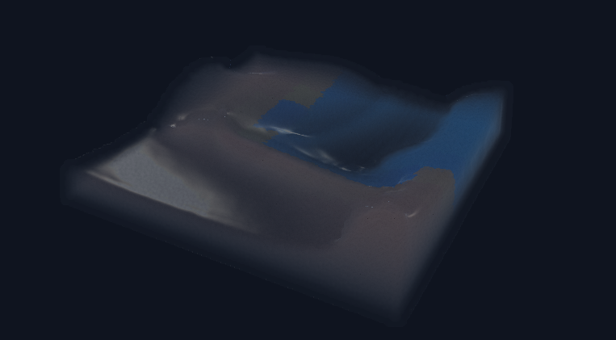

# PhreeGUI
> Building the most authentic educational-grade chemical simulation GUI system.

## 📖 About

Aiming to solve the **"impossible triangle"** of current chemical simulation software: *ease-of-use vs. realism vs. cost*. We've developed a demo for you to experience.



## ✨ Features

- 🚀 **High Fidelity**: Powered by **Phreeqcrm** for the chemical core, **splishsplash** with **DFSPH** for the physics core, and **SSFR** for rendering — achieving near-research-grade realistic simulations.
- 🛠 **User-Friendly**: Get started in just three steps: **Clone → Install → Run**.
- 🔌 **Extensible**: Rich APIs and hooks reserved for developers and advanced customization.

## 📦 Installation

Ensure you have the required dependencies installed (Python 3.8+, etc.).

```bash
pip install -r requirements.txt
```

## 🚀 Quick Start

1. Open `launch_coupled_simulation.py`
2. Click **"Start Simulation"**
3. View the simulation status in the **3D viewport** on the right
   - 🖱️ **Left-click**: Create particles
   - 🖱️ **Right-click + drag**: Move the camera

> 💡 Tip: For more advanced usage, check out the [Documentation](#) (coming soon).

## 🤝 Contributing

We welcome contributions of all kinds!

1. Fork the repository
2. Create your feature branch (`git checkout -b feature/AmazingFeature`)
3. Commit your changes (`git commit -m 'Add some AmazingFeature'`)
4. Push to the branch (`git push origin feature/AmazingFeature`)
5. Open a Pull Request

## 🙏 Acknowledgements

This project adopts a **Vibe Coding** workflow, significantly accelerating iteration speed. Special thanks to the following AI tools for their intelligent assistance:

- 🤖 [GitHub Copilot](https://github.com/features/copilot)
- 🧠 [Qwen (Tongyi Qianwen)](https://tongyi.aliyun.com/)
- 🌕 [Kimi AI](https://kimi.moonshot.cn/)

Thanks to these powerful AI pair programmers for turning ideas into code faster! 🚀

## 📄 License

This project is licensed under the **GNU General Public License v3.0** — see the [LICENSE](./LICENSE) file for details.

> In short: You can use, modify, and distribute this software, but any derivative work must also be open-sourced under GPL v3.

## 📬 Contact

- **Author**: mimi
- **Email**: [mimi99258@outlook.com](mailto:mimi99258@outlook.com)

---
*Made with ❤️ and 🤖 by mimi*

